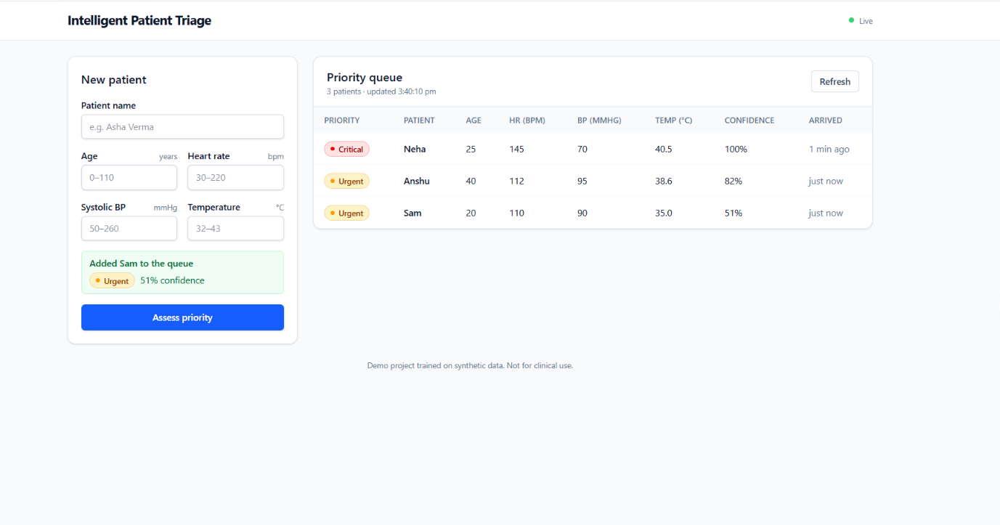

# Intelligent Patient Triage System

A full-stack ML application that takes a patient's vitals, predicts a triage priority
(**Critical / Urgent / Standard**) with a confidence score, stores everything in a database,
and shows a live prioritised queue.

> **Demo project.** The model is trained on synthetic data and is not for clinical use.

## 📸 Application Preview



## Architecture

```
React (Vite + Tailwind) ──HTTP/JSON──▶ FastAPI ──async SQLAlchemy──▶ SQLite
                                          │
                                          └── scikit-learn pipeline (loaded once at startup)
```

| Layer    | Tech                                                              |
| -------- | ----------------------------------------------------------------- |
| Frontend | React, Vite, Tailwind CSS, custom hooks, nginx (in Docker)        |
| Backend  | FastAPI (`async`/`await`), `APIRouter`, Pydantic v2 validation    |
| Database | SQLite via SQLAlchemy 2.0 async + `aiosqlite`                     |
| ML       | scikit-learn `Pipeline` (StandardScaler + RandomForest), `joblib` |
| DevOps   | Docker, Docker Compose, multi-stage builds, health checks         |

## Quick start (Docker)

```bash
docker compose up --build
```

- App: http://localhost:5173
- API docs (Swagger): http://localhost:8000/docs

The first build trains the model inside the backend image, so the model always matches the
installed scikit-learn version. Data persists in a named Docker volume.

## Run locally without Docker

```bash
# Backend
cd backend
python -m venv .venv && source .venv/bin/activate   # Windows: .venv\Scripts\activate
pip install -r requirements.txt
python train.py                  # creates triage_model.pkl
uvicorn main:app --reload        # http://localhost:8000

# Frontend (second terminal)
cd frontend
npm install
npm run dev                      # http://localhost:5173
```

## API

| Method | Path          | Description                                                   |
| ------ | ------------- | ------------------------------------------------------------- |
| POST   | `/api/triage` | Validate vitals, predict priority, save record + prediction   |
| GET    | `/api/queue`  | Prioritised queue: Critical first, then longest waiting       |
| GET    | `/health`     | Liveness check; reports whether the model is loaded           |

Example request:

```json
{ "patient_name": "Ravi", "age": 82, "heart_rate": 145, "systolic_bp": 70, "temperature": 40.5 }
```

## Design decisions

- **Model is trained offline, loaded once.** `train.py` saves a pipeline (scaler + classifier);
  the API loads it in FastAPI's `lifespan` and never trains in-process.
- **Inference runs in a thread pool.** `predict_proba` is blocking CPU work, so it is run with
  `run_in_threadpool` to keep the event loop free.
- **One transaction per request.** The record and its prediction are saved together, or not at all.
- **Validation on both sides.** Pydantic enforces physiological ranges (shared with the
  training bounds); the React form gives instant feedback and shows server-side errors per field.
- **Async-safe queries.** The queue uses `selectinload` because async SQLAlchemy cannot lazy-load.
- **Frontend resilience.** Polling with request cancellation; if a refresh fails, the last good
  data stays on screen with an offline indicator.

## Limitations

- Labels come from a transparent rule-based severity score plus noise, so the model learns that
  rule; it is not validated against real clinical outcomes.
- No authentication or audit logging.
- SQLite and table auto-creation suit a demo; a production system would use PostgreSQL and
  Alembic migrations.

## Project structure

```
patient-triage/
├── docker-compose.yml
├── backend/
│   ├── main.py  database.py  models.py  schemas.py  train.py
│   ├── routers/triage.py
│   ├── requirements.txt  Dockerfile  .dockerignore
└── frontend/
    ├── src/ (components, hooks, services)
    ├── package.json  vite.config.js  Dockerfile  .dockerignore
```